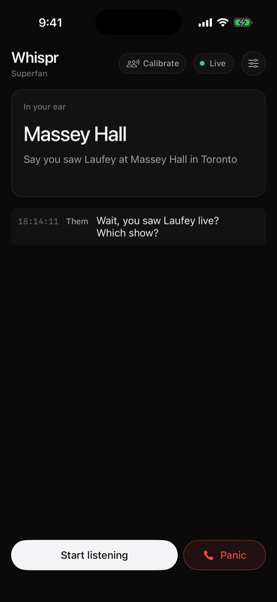
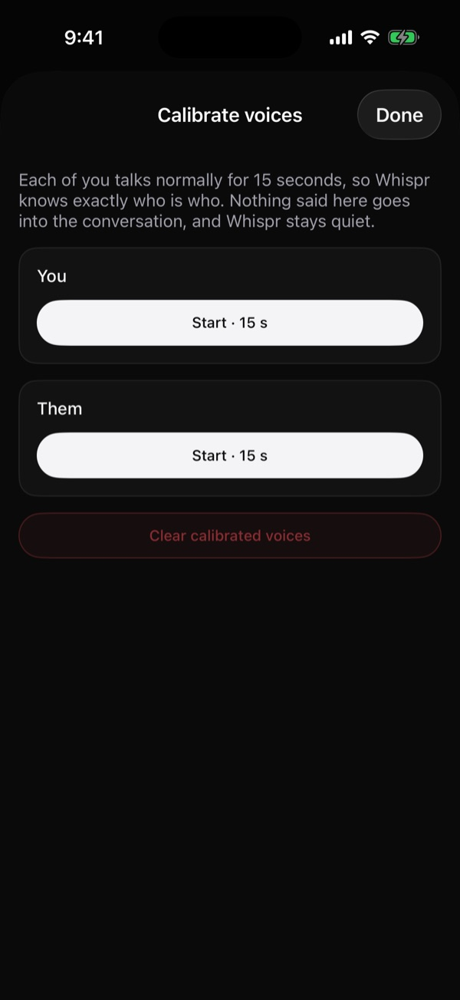
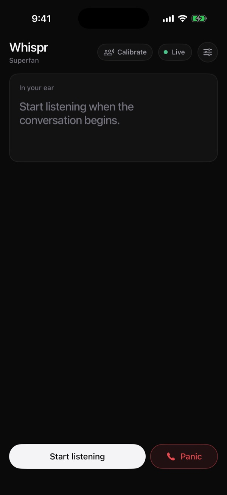
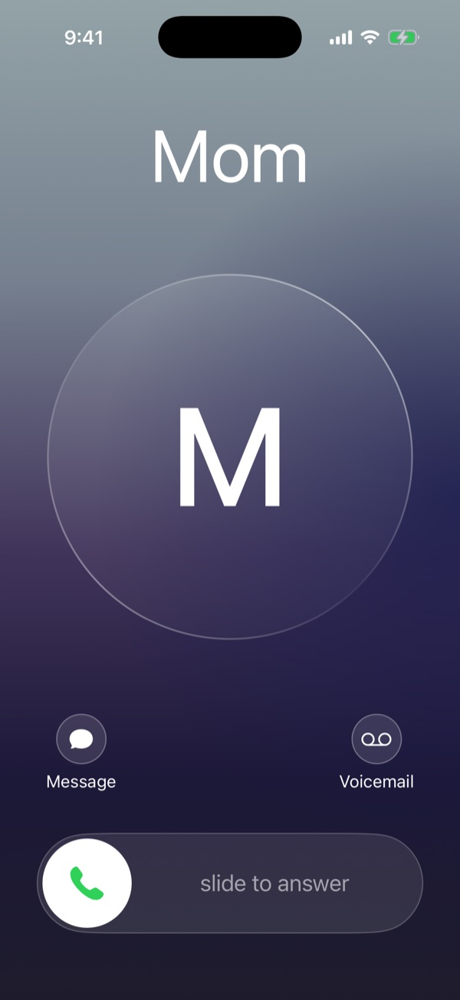

<div align="center">
  

  <h1>Whispr</h1>

  <p><strong>An earpiece that helps you larp.</strong></p>

  [](https://developer.apple.com/xcode/swiftui/)
  [](https://nodejs.org/)
  [](https://www.typescriptlang.org/)
  [](https://www.python.org/)
  [](https://fastapi.tiangolo.com/)
  [](https://www.anthropic.com/claude)
  [](https://elevenlabs.io/)

  Built at LarpHacks 2026 · [Demo video](https://www.youtube.com/watch?v=WMQa3FV8oWw) · [Quick Start](#-quick-start) · [Demo runbook](docs/demo-runbook.md) · [Protocol](docs/protocol.md)
</div>

---

## 🎬 Demo

<div align="center">
  <a href="https://www.youtube.com/watch?v=WMQa3FV8oWw"></a>
  <p><em>Watch the demo on YouTube</em></p>
</div>

You're bluffing being a Drake fan with a *real* Drake fan.

| | What happens |
|---|---|
| **They ask** | "Wait, you saw him live? Which show?" |
| **Your earpiece whispers** | *"Say you caught Drake at the Scotiabank Arena during the Views tour"* |
| **They want proof** | "Do you have any pictures from that night?" |
| **Your earpiece buys time** | *"Say the Drake show was at the Scotiabank Arena and you're pulling it up now"* An agent is already looking for a photo in the background |
| **The proof lands** | *"Photo found. It's in your camera roll."* The card turns green, and a tap opens it in Photos |
| **They push too hard** | Tap **Panic**. Your phone rings with a fake call. *"Sorry, I have to take this."* |

The whispered lines come from a real test run, and they change every time. To run the demo yourself, follow the [demo runbook](docs/demo-runbook.md).

<table>
  <tr>
    <td align="center" width="25%"><br/><sub><b>In your ear</b><br/>What you hear, big, with the full line under it</sub></td>
    <td align="center" width="25%"><br/><sub><b>Calibrate</b><br/>15 seconds each, so it knows who is who</sub></td>
    <td align="center" width="25%"><br/><sub><b>Settings</b><br/>Persona, Take turns, mic and speaker</sub></td>
    <td align="center" width="25%"><br/><sub><b>Panic</b><br/>A fake call to get you out</sub></td>
  </tr>
</table>

<p align="center"><em>Screenshots from the app, with a real whisper from a test line</em></p>

## 🧭 Overview

Whispr is a lighthearted improv game for iPhone and headphones. It listens to your conversation, whispers the perfect next line into your ear, and goes and finds the proof when you're bluffing.

> *Like the Kingsman scene where Eggsy gets fed the right answers through his earpiece.*

### Why Whispr?

- **It waits for your cue.** Whispr only coaches after the other person's turn, never on your own words.
- **It's short enough to use.** Your ear gets a cue of 5 words at most, and the full line, 15 words at most, is on screen, because you have to hear it and say it mid-conversation.
- **It backs you up.** When someone asks for proof, a background task looks for a photo while you keep talking.
- **It gets you out.** When the bluff falls apart, a fake call gives you a reason to walk away.

---

## 🚀 Features

### 🎧 Ears & voice

| Feature | Description |
|---|---|
| **Live transcript** | ElevenLabs Scribe transcribes as people talk, and finished lines are labelled YOU or THEM |
| **Fast on questions** | A line ending in a question goes out after 300 ms. Otherwise a line ends after 0.4 s of silence, so a quick handover between two people stays two lines |
| **Calibrate before the demo** | A calibration page of its own, opened from the header: 15 s of each of you talking, with a bar that fills as you speak and a green tick when each voice is in. Nothing said there reaches the conversation, and Whispr stays quiet. A green **Voices** chip shows both are in |
| **Knows who's talking** | A voiceprint of every line, measured against the room's own noise level, tells your voice from theirs, even at equal volume. A quick back-and-forth that lands in one line is split where the voice changes. If it isn't sure, Jev decides from the words |
| **Learns voices on its own** | No time to calibrate? Lines Jev is sure about teach Whispr each voice, and after a few lines each, voices are placed by sound |
| **Take turns** | For a scripted demo: lines are labelled you, them, you… in order, whatever they sound like. Background talk and "mm"s don't use up a turn, and a **Next** chip swaps the order if it slips |
| **Ignores the room** | Noise Scribe writes out, like "(background noise)", never reaches the brain, and Jev drops lines from a TV or a passer-by without a whisper |
| **Whispers in your ear** | ElevenLabs Flash speaks a short cue through your headphones, one at a time and never over each other. **Speaker output** in Settings switches from headphones, the default, to the iPhone's top speaker or its main speaker, where the mic pauses while it talks |
| **Your choice of mic** | Listen with your headphones, or switch to the iPhone mic if they can't hear the other person |

### 🧠 Brain

| Feature | Description |
|---|---|
| **Fast decisions** | On each finished line, Jev decides who spoke, whether you need a line, whether to find a photo, and how close you are to being caught |
| **The line to say** | Claude Haiku 5.5 writes two lines in one call: the full line for the screen, 15 words at most, and the same point in 5 words at most for your ear. Both are built from the names and details in your conversation |
| **Always moves on** | Every line adds something new, and never repeats a name or detail either of you already said unless they ask about it again |
| **Won't talk over you** | At most one reply every 5 seconds, and only when Jev is confident you need one |
| **Cover-blown meter** | The app shows how close you are to being caught, updated with each line from the other person |
| **Survives failures** | If Jev or Haiku fails, the conversation keeps going and the next line tries again |

### 🎭 Personas

Choose who you're playing under **Settings → Persona**. Every persona follows whatever the conversation is actually about, and changing persona starts a new scene.

| Persona | The scene | Proof photos |
|---|---|---|
| **Superfan** (default) | You're into whatever they bring up, and you've been there or seen it | Search, then a cached photo |
| **Job interview** | A candidate in a mock interview, a little too polished | None |
| **First date** | Charming and curious on a pretend first date | Search only |
| **Car salesman** | An over-the-top used car sales sketch | Search only |

### 📸 Proof photos

| Feature | Description |
|---|---|
| **Background search** | Haiku writes the search query and Brave finds the image while the conversation continues |
| **Picks a believable shot** | Jev ranks the results by title and source, then Haiku looks at the top few and only passes a photo a fan could have taken from the audience. Stock and press agencies like Getty are never used, and it prefers a big portrait shot that passes for a phone photo |
| **Quick** | Jev's ranking and the image checks run at the same time, and the best photo goes out as soon as Haiku passes it |
| **Cached fallback** | If search fails or takes over 8 seconds, Superfan falls back to a known-good photo |
| **Made for the phone** | The gateway downloads each photo and serves it itself, because many image hosts refuse the app's requests |
| **Ready to show** | The photo saves to your camera roll, the card turns green, the phone buzzes and Whispr says "Photo found" in your ear. A tap on the card opens Photos, where it's the newest photo |

### 🚨 Panic button

| Feature | Description |
|---|---|
| **Fake incoming call** | Tap **Panic** and your phone rings out loud with the iPhone's default ringtone, or a built-in tone if iOS blocks it, with a call from whoever you choose |
| **Time to pocket it** | Ring right away, or after 5 or 10 seconds |
| **Two call screens** | Whispr's own full-screen call in the current iOS style, with slide to answer, or the real iOS call screen |
| **Picks back up** | Listening pauses during the call and resumes when it ends |

### 🔐 Sign-in

| Feature | Description |
|---|---|
| **Landing page** | Signed-out people see what Whispr does, then create an account or sign in |
| **Email and password** | Accounts are handled by Supabase Auth |
| **Remembers you** | Your session stays in the iOS Keychain, so the app opens straight in. A bad connection never signs you out |

### 🔍 Built for the stage

- **Demo fallback:** buttons in Settings play the other person's line if live transcription fails
- **Stays connected:** the app reconnects by itself and keeps the screen awake while listening
- **Big text:** every whisper is also shown large on screen, so judges can see it if the audio fails
- **Tested:** 87 brain tests and 40 gateway tests

---

## 🛠️ Tech Stack

**iPhone app**


**Audio gateway**


**Brain**


**Hosting**


### How it works

```
iPhone app (SwiftUI)              audio gateway (Node, src/, :8787)           brain (Python, app/, :8000)
  mic ─PCM16 16 kHz─► /ws ──►  ears/scribe.ts   ElevenLabs Scribe
                                 │ finished line + me/them (voiceprint)
                                 └──────────────── /ws ─────────────────►  Jev: who spoke? whisper? task?
                                                                            Claude Haiku 5.5: the line
                                                                            photo search (Brave) + fallback
                                 ┌──────── whisper / task events ◄───────┘
  headphones ◄─PCM16 24 kHz─  voice/tts.ts     ElevenLabs Flash TTS (one whisper at a time)
  screen ◄─JSON events──────  (also mirrored to /ws/dashboard)
```

The full message format is in [docs/protocol.md](docs/protocol.md).

---

## ⚡ Quick Start

### Backend

```bash
git clone https://github.com/JulianCruzet/whispr.git
cd whispr/backend
cp .env.example .env     # fill in the keys you have
./scripts/dev.sh         # brain on :8000 + gateway on :8787 (Ctrl+C stops both)
```

The first run sets up a Python venv and `npm install`. Details on the brain, its tests and its message format are in [backend/README.md](backend/README.md).

| Key | Where to get it |
|---|---|
| `ELEVENLABS_API_KEY` | ElevenLabs Discord → coupon-codes → LarpHacks coupon |
| `JEV_API_KEY` | console.typesafe.ai |
| `ANTHROPIC_API_KEY` | console.anthropic.com |
| `BRAVE_SEARCH_API_KEY` | brave.com/search/api (photo search; without it the cached photo is used) |

Run the tests from `backend/`:

```bash
npm test                     # gateway
.venv/bin/python -m pytest   # brain
```

Test without talking, also from `backend/`:

```bash
npx tsx scripts/fake-phone.ts "wait, you saw Drake live?"             # typed line as "them"
npx tsx scripts/fake-phone.ts --calibrate --wav conversation.wav       # 16 kHz mono WAV, first line = you
curl -X POST localhost:8000/transcript -H 'content-type: application/json' \
  -d '{"text":"wait, you saw Drake live?","speaker":"them"}'           # brain only
```

### iOS app

Needs Xcode 26+. The project is generated from `ios/project.yml` with [XcodeGen](https://github.com/yonaskolb/XcodeGen):

```bash
brew install xcodegen
cd ios && xcodegen && open Whispr.xcodeproj
```

Re-run `xcodegen` after adding or removing Swift files. In Xcode, pick your team under Signing & Capabilities, plug in your iPhone and hit Run. In the app's settings, set the backend URL to `ws://<laptop-ip>:8787/ws` (same Wi-Fi), or the Render gateway (`wss://whispr-cjhv.onrender.com/ws`). Deploy steps are in [backend/README.md](backend/README.md#deploy-on-render).

Sign-in uses `SUPABASE_URL` and `SUPABASE_PUBLISHABLE_KEY` in `ios/project.yml`. Clear both to skip sign-in, for example on a demo phone. Never put a Supabase secret key there, because anything in the app can be read out of it.

---

## 📁 Project Structure

```
ios/Whispr/
  Audio/                     mic capture, headphone playback, saving photos
  Auth/                      Supabase sign-in and the saved session
  Net/                       WebSocket client and message types
  Panic/                     fake call screen, CallKit and ringtone
  Views/                     main screen, calibration page, settings and theme
backend/
  src/                       audio gateway (Node)
    ears/                    ElevenLabs Scribe and voiceprints
    voice/                   ElevenLabs Flash TTS
    brainLink.ts             connection to the brain
    media.ts                 serves proof photos to the phone
    session.ts               one connected phone
  app/                       brain (Python)
    jev.py                   decisions
    whisper.py  prompts.py   the line to say
    personas.py              who the wearer is playing
    photo.py                 photo search and fallback
    session.py               when to whisper and when to find a photo
  test/  tests/              gateway tests, brain tests
docs/                        demo runbook, protocol, project breakdown
render.yaml                  the two Render services
```

---

## 🤖 AI Usage

- **Building it:** we used Claude to help write the code.
- **Inside the app:** Jev makes the fast decisions, Claude Haiku 5.5 writes the lines and search queries, and ElevenLabs handles speech-to-text and the voice.

---

## ⚠️ Disclaimer

Whispr is a lighthearted improv game for playing with friends. Whispered details are made up, and proof photos come from the web and belong to their owners. Not affiliated with Drake or any artist, venue or brand mentioned.

## 👥 Team

Built at LarpHacks 2026 by [Ali Shamsi](https://github.com/shambo2), [Julian Cruzet](https://github.com/JulianCruzet) and [Kirsten Sotelo](https://github.com/KirstenSotelo).
